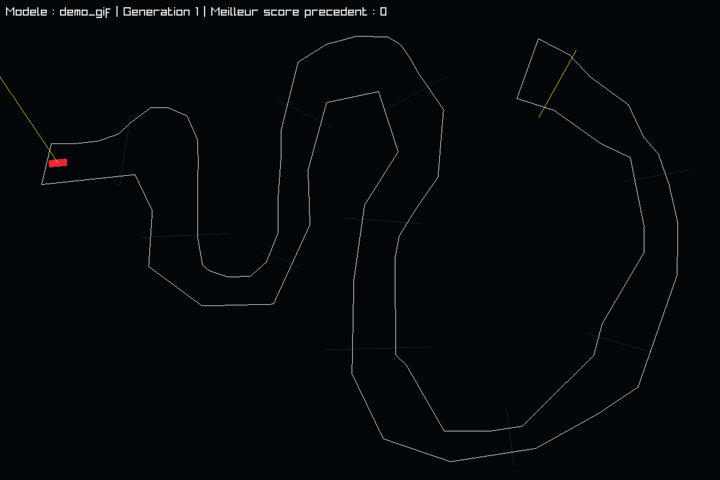
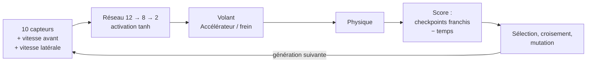

# Neuro-Trackmania


Jeu de course 2D en C++ où des voitures pilotées par un **réseau de neurones** apprennent à finir un circuit par **neuroévolution**. Aucune bibliothèque d'IA : le réseau, l'algorithme génétique, la physique et l'interface sont écrits à la main, au-dessus de [raylib](https://www.raylib.com/).

<p align="center">
  
  <br>
  <em>Génération 1 : réseaux aléatoires, les voitures s'écrasent dès les premiers virages.<br>
  Génération 28 : la population a appris le circuit et franchit la ligne d'arrivée.</em>
</p>

## Fonctionnalités

- **Entraînement d'IA** : 2 à 300 voitures par génération, sur le circuit de son choix, avec les capteurs visibles en temps réel.
- **Modèles persistants** : le meilleur réseau est sauvegardé automatiquement à chaque génération. On peut reprendre un ancien modèle plus tard, ou sur un autre circuit.
- **Éditeur de circuits** : tracé des murs à la souris, départ, direction, ligne d'arrivée et checkpoints, puis sauvegarde nommée.
- **Mode jeu** : piloter soi-même au clavier et battre son meilleur temps.
- **Interface maison** : boutons, listes défilantes, champs de saisie, popups, construits comme des composants React réutilisables.

## Comment ça marche



**Perception.** Chaque voiture lance 10 rayons répartis sur un cône de 90° devant elle, d'une portée de 500 px. Chaque rayon renvoie la distance au mur le plus proche, ramenée entre 0 et 1. Le réseau reçoit aussi la vitesse de la voiture dans son propre repère : vers l'avant (négative en marche arrière) et sur le côté (le dérapage).

**Décision.** Un perceptron multicouche de 12 entrées, 8 neurones cachés et 2 sorties, avec l'activation `tanh`. Les deux sorties, entre -1 et 1, commandent le volant et la pédale (accélération ou freinage).

**Évaluation.** Le score d'une voiture vaut `1000 × (checkpoints franchis + avancement vers le suivant) − 10 × temps écoulé`. Les checkpoints doivent être franchis dans l'ordre, ce qui empêche de couper. Une voiture est éliminée si elle touche un mur, si elle ne progresse plus pendant 3 s, ou si elle roule trop lentement trop longtemps.

**Évolution.** Quand toutes les voitures sont éliminées, la génération suivante est construite ainsi :
- les **10 %** meilleurs réseaux sont conservés tels quels (élitisme) ;
- les autres sont des **enfants** de deux parents tirés parmi les **20 %** meilleurs : chaque neurone, avec son biais et ses poids, vient de l'un ou de l'autre ;
- chaque poids d'un enfant a **10 %** de chances d'être modifié par un bruit gaussien (écart-type 0,3).

## Démarrage rapide

Prérequis : un compilateur C++20, `make` et raylib 5.5.

**macOS**
```bash
brew install raylib
make run
```

**Linux** (raylib installé dans `/usr/local`, son emplacement par défaut)
```bash
make run
```

**Windows (MinGW)**
1. Télécharger `raylib-5.5_win64_mingw-w64.zip` depuis les [releases de raylib](https://github.com/raysan5/raylib/releases) et le décompresser.
2. Copier `config.mk.example` en `config.mk` et y indiquer le dossier décompressé :
   ```make
   RAYLIB_PATH = C:/chemin/vers/raylib-5.5_win64_mingw-w64
   ```
3. Lancer `make run`.

`config.mk` est ignoré par git : chacun garde son propre chemin. Le jeu se lance depuis la racine du projet, pour trouver le dossier `assets/`.

| Commande | Effet |
|---|---|
| `make` | compile dans `build/`, en ne recompilant que les fichiers modifiés |
| `make run` | compile puis lance le jeu |
| `make clean` | supprime `build/` |

## Utilisation

**Entraîner une IA.** *Entraîner* → choisir un circuit, un modèle (nouveau ou existant) et le nombre de voitures → *Lancer*. Le modèle est enregistré dans `assets/models/` à la fin de chaque génération. L'écran prévient si le circuit n'a pas de checkpoints, car sans eux l'IA apprend mal.

**Créer un circuit.** *Éditeur* → cliquer pour tracer les murs, puis cliquer près du premier point pour fermer le tracé. Ensuite : un clic pour le départ, un clic pour la direction, deux clics pour la ligne d'arrivée, puis deux clics par checkpoint, dans l'ordre de passage. *Enregistrer* (ou `G`) demande un nom.

**Jouer.** *Jouer* → choisir un circuit et faire le meilleur temps.

| Écran | Commandes |
|---|---|
| Jeu | `↑` `↓` `←` `→` conduire · `R` recommencer · `Échap` pause |
| Éditeur | clic placer · `W` `A` `S` `D` caméra · `Q` / `E` zoom · `Retour arrière` annuler un checkpoint · `Espace` tout effacer · `G` enregistrer |
| Entraînement | `W` `A` `S` `D` caméra · `Q` / `E` zoom · `Échap` pause |

## Architecture

```
src/
├── main.cpp
├── core/      boucle principale, pile d'états, rendu, générateur aléatoire
├── states/    écrans : menu, pause, jeu, sélection, éditeur, configuration et entraînement
├── game/      voiture, circuit, géométrie
├── ai/        voiture IA (capteurs, score), réseau de neurones
├── editor/    éditeur de circuit
├── io/        lecture et écriture des circuits et des modèles
└── ui/        composants d'interface réutilisables
assets/
├── tracks/    circuits (.txt)
└── models/    réseaux entraînés (.txt)
docs/          documentation et médias
```

Quelques choix de conception :

- **Pile d'états.** Chaque écran est un `State` qui possède ses données. `App` garde une pile de `std::unique_ptr<State>`, et la pause est simplement un état empilé par-dessus le jeu. Les changements d'écran demandés pendant une frame ne sont appliqués qu'après le rendu, pour qu'un écran ne soit jamais détruit pendant que son propre code s'exécute.
- **Interface déclarative.** Les écrans décrivent leur interface comme un arbre de composants avec des props, à la manière de React. `ui::Root` reconstruit l'arbre quand l'état change :

  ```cpp
  ui::column({.spacing = 20},
      ui::label({.text = "Nombre de voitures", .fontSize = 24}),
      ui::stepper({.value = carCount, .min = 2, .max = 300, .steps = {10, 1},
                   .onChange = [this](int value) { carCount = value; }}),
      ui::button({.text = "LANCER", .onClick = [this, app] { launch(app); }})
  );
  ```

  Composants disponibles : `button`, `label`, `column` / `row`, `scrollView`, `textInput` (avec focus), `modal`, `stepper`.
- **Fichiers robustes.** Un circuit ou un modèle invalide renvoie une erreur affichée à l'écran, sans planter le jeu. Les modèles sont écrits dans un fichier temporaire puis renommés, pour ne jamais laisser un fichier à moitié écrit.
- **Compatibilité des modèles.** Un ancien modèle avec moins d'entrées est adapté au chargement : les nouvelles entrées reçoivent un poids nul, il se comporte donc exactement comme avant puis apprend à s'en servir.

## Formats de fichiers

Les circuits et les modèles sont des fichiers texte lisibles, faciles à versionner.

**Circuit** (`assets/tracks/<nom>.txt`)
```
S x,y              départ
A angle            direction de départ, en radians
F x1,y1;x2,y2      ligne d'arrivée
C x1,y1;x2,y2      checkpoint (optionnel, dans l'ordre de passage)
x1,y1;x2,y2        segment de mur
<EOF>
```

**Modèle** (`assets/models/<nom>.txt`)
```
NEURAL_NETWORK 1
GENERATION 42          générations déjà entraînées
TOPOLOGY 12 8 2        neurones par couche
b w1 w2 ... wn         une ligne par neurone : biais puis poids entrants
```

## Feuille de route

- [ ] Simulation découplée du rendu (pas de temps fixe), pour entraîner beaucoup plus vite et rendre la physique indépendante du nombre d'images par seconde.
- [ ] Courir contre le meilleur modèle, affiché comme un « fantôme » dans le mode jeu.
- [ ] Ouvrir et modifier un circuit existant dans l'éditeur.
- [ ] Vérifier les checkpoints en mode jeu, comme pour l'IA.
- [ ] Physique plus réaliste : adhérence latérale, braquage qui dépend de la vitesse.
- [ ] Tests automatisés (`make test`).
